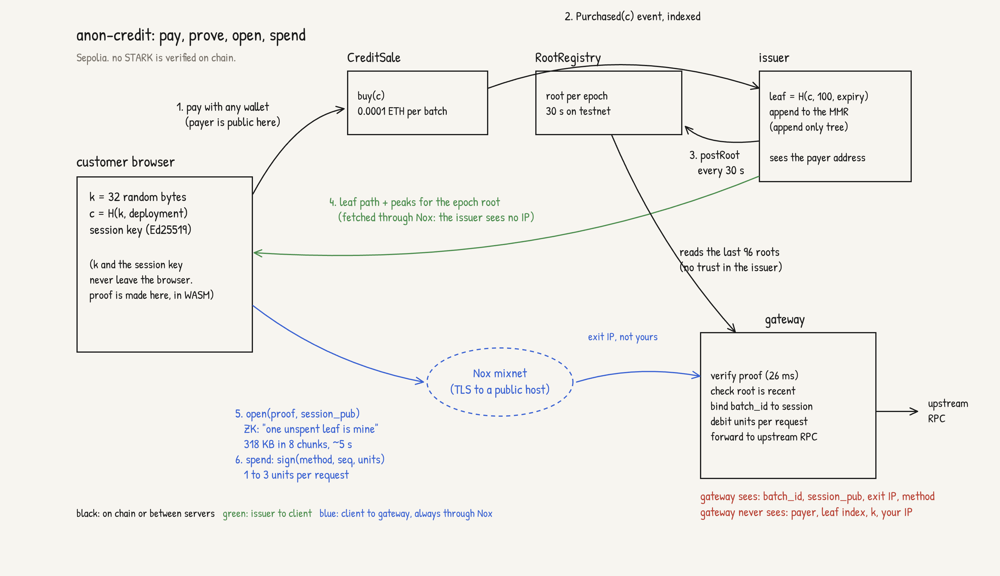

<p align="center"></p>

# anon-credit

An RPC gateway that takes no API key, no login, and no IP address.

A customer prepays for a batch of 100 requests on a Sepolia contract. The client then proves in the browser, with a zero-knowledge proof, that it owns one unspent batch, without saying which one. The gateway opens a session for that proof, and each request inside the session is a signed debit. The gateway never learns who paid. All traffic to the gateway goes through the Nox mixnet, so the gateway does not see the customer's IP address either.

Built at ETHGlobal Mumbai, 2026.

## How it works



```
 customer                      issuer                      gateway
 --------                      ------                      -------
 k = random 32 bytes
 c = H(k, deployment)
 pay CreditSale(c)  --------> sees the purchase
                              leaf = H(c, K=100, expiry)
                              appends the leaf to an MMR
                              posts the root each epoch ---> reads the root (RootRegistry)

 ZK proof: "a leaf in this root
 is mine and unspent"
 open(proof, session_pub) ----------- Nox ---------------> verifies, opens a session
 sign(method, params, seq) ---------- Nox ---------------> debits 1 unit, answers
```

- **Commitment and leaf.** Poseidon2 over BN254, the same construction in Rust, TypeScript, and Noir, pinned by shared fixtures.
- **Tree.** A Merkle Mountain Range. Append only, no node is ever rewritten, and a client can rebuild its path from events. The root commits to the leaf count, so the anonymity set size is public.
- **Proof.** A Noir circuit, `circuits/batch-open`, proved in the browser with [ProveKit](https://github.com/worldfnd/ProveKit) in hiding mode. Ten public inputs: circuit id, deployment id, gateway id, root, leaf count, proof epoch, batch id, and the binding to the session key. About 14,000 R1CS constraints. Proving takes 3 to 6 s in Chrome.
- **Session.** The open proof binds a fresh Ed25519 key. Each request is signed over the batch id, a sequence number, the cumulative units, and the request bytes. Every signed request is also a settlement receipt.
- **Transport.** The browser talks to the gateway through [Nox](https://github.com/ethereum/anon-rpc), the Anon-RPC mixnet. Nox limits a request body to about 48 KB, so the 318 KB proof goes in 8 raw chunks in flight at the same time, about 5 s end to end.
- **Verification.** The gateway calls a Rust verifier sidecar over loopback. One verify is about 26 ms.

What the gateway holds for a session: a batch id, a session public key, units left, and a Nox exit address. What it does not hold: a payer, a leaf index, or a customer IP.

## Live on Sepolia

| Contract | Address |
|---|---|
| CreditSale | [`0x121f911867ac81aeba7d41ddfbfadec2a1787acb`](https://sepolia.etherscan.io/address/0x121f911867ac81aeba7d41ddfbfadec2a1787acb) |
| RootRegistry | [`0xa7804062bfe4b4205b8597a477e3b039981fb7e8`](https://sepolia.etherscan.io/address/0xa7804062bfe4b4205b8597a477e3b039981fb7e8) |

Testnet profile: 30 s epochs, 0.0001 ETH per batch of 100 units, chain reads at the `latest` block tag, no first-use delay. A purchase can open a session 40 to 80 s later. Production uses 900 s epochs, the `finalized` tag, and a random first-use delay of up to three epochs. See [RUNBOOK.md](RUNBOOK.md).

## Repository

| Path | What |
|---|---|
| `circuits/batch-open` | The Noir circuit and its fixtures |
| `crates/crypto`, `crates/protocol` | Poseidon2, MMR, signing messages, API types (Rust) |
| `crates/issuer` | Indexes purchases, builds the tree, posts roots, serves paths |
| `crates/gateway` | Open and spend pipelines, chunked upload, admin API, SSE events |
| `crates/prover` | ProveKit verifier adapter and the loopback sidecar (nightly Rust) |
| `contracts/` | `CreditSale`, `RootRegistry`, Foundry tests and deploy script |
| `packages/crypto`, `packages/protocol` | The same primitives in TypeScript |
| `packages/prover` | Browser prover on the pinned ProveKit WASM build |
| `packages/sdk` | Client: purchase, state, open, spend, backup |
| `packages/anon-transport` | Nox transport wrapper and the direct fallback |
| `packages/app` | Customer web app: buy, wait, open, spend ([README](packages/app/README.md)) |
| `packages/dashboard` | Operator dashboard on the live event stream |
| `examples/e2e` | Sepolia end-to-end run and the local integration harness |
| `fixtures/protocol` | Cross-language test vectors |
| `tooling/` | ProveKit pins and builds, deploy helper, service launcher |

Documents: [PRD.md](PRD.md) for requirements, [Architecture.md](Architecture.md) for the design, [implementation.md](implementation.md) for the build plan and every protocol constant, [PROVER.md](PROVER.md) for the ProveKit notes, [FUTURE.md](FUTURE.md) for the path to no issuer and many gateways, [RUNBOOK.md](RUNBOOK.md) for operation, and [REFERENCE.md](REFERENCE.md) for the full technical reference of each component.

## Run it

Needs Rust stable and the pinned nightly, Node 26 with pnpm 12, Foundry, and Noir `1.0.0-beta.26`. Versions are in [REFERENCE.md](REFERENCE.md).

```sh
pnpm install
./check.sh                 # fmt, clippy, cargo test, typecheck, vitest, forge, nargo, secret scan
pnpm test:integration      # the whole flow on a local anvil chain, 15 steps, about 25 s
```

The integration harness runs the real contracts, issuer, gateway, verifier sidecar, and the browser prover in headless Chrome, on the direct transport.

Against Sepolia:

```sh
cp config/testnet-demo.env.example config/testnet-demo.env   # fill in the RPC URL and keys
tooling/deploy/deploy-sepolia.sh                              # or use the addresses above
tooling/dev/run-services.sh                                   # sidecar, issuer, gateway
pnpm app:dev                                                  # customer app
pnpm dashboard:dev                                            # operator dashboard
pnpm example:e2e                                              # scripted run through Nox
```

The Nox exits cannot reach `localhost`. A run through Nox needs the issuer and the gateway behind public HTTPS hostnames.

## Known limits

- Requests inside one session are linkable by design. The batch size `K` is the privacy dial.
- The gateway sees query content. A client that wants content privacy must change what it asks.
- ProveKit's hiding mode is stated by its own source as not full zero knowledge. Read the hiding-mode section of [PROVER.md](PROVER.md) before any production privacy claim.
- The proof is 318 KB and single-core verification is 26 ms. Both are above the targets in the PRD.
- The beta has one issuer and one gateway. [FUTURE.md](FUTURE.md) describes how both become contracts.

## License

MIT OR Apache-2.0
